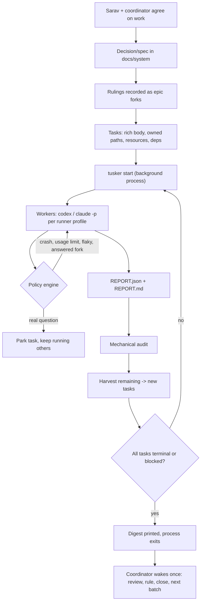

# Coordinator batch mode

Status: proposal, 2026-10-08. Author: the Claude Code coordinator on the rzn backend, at Sarav's request. Audience: the Tusker team.

Implementation: the foreground batch commands and supporting features now exist. See [Coordinator batches](../coordinator-batches.md) for current behavior, verification commands, and the remaining production rollout exercises.

## 1. Why this exists

Tusker was built for a world where several agents from different vendors (Codex, Claude Code, Devin, Muse) worked the same repo and nobody trusted anybody. Leases, wave arming, review levels and the resident daemon enforced order between them.

The rzn backend now runs a different way. One frontier model (Claude) coordinates. Cheap workers do the work: Codex `gpt-6.1-sol` at low or medium effort for code, `claude --model opus` for review. The coordinator talks with Sarav, writes specs and rulings, dispatches lanes, reviews results and decides the next step.

That works, but the coordinator does mechanical work that a program should do, and work still falls through gaps. This proposal makes Tusker the tool that removes both problems. It reuses Tusker's existing task model, docs, models/profiles and runs. It does not add ceremony.

### Evidence from one campaign (rzn backend, 2026-10-07 evening to 2026-10-08 morning)

| Fact | Number |
|---|---|
| Lanes run by the coordinator | 11 (ROWFETCH, ROWFETCH2, PREFILTER-DESIGN, PHASE2, PHASE2-FIX, NIGHT-BOX, BOX, GROUPING, DOCS, LANCE-LAYOUT, plus one Opus review subagent) |
| Product code written by the coordinator | 0 lines |
| Brief size per lane | 2–7 KB |
| Worker log size per lane | 0.13–3.4 MB |
| Coordinator relaunches for mechanical reasons | 5: two unrelated flaky tests, one Codex crash (exit 101), two lanes that stopped on a question the coordinator could answer from earlier rulings |
| Hand-written orchestration scripts | a dependency chain (`night-chain.sh`), a PID waiter (`wait.sh`), a lane runner with usage-limit retry (`sol-lane2.sh`) |
| Follow-ups living only in chat or a handoff note | 8 (flaky test, cross-tenant head epoch, 429s at 150 QPS, scratch files committed by lanes, and others) |
| Tusker tasks used | 0. The one lookup a lane tried returned NOT_FOUND. The vault holds 94 open tasks from old waves, mostly stale. |

The token cost is not in waiting: the coordinator's waiters are shell processes and cost nothing while a lane runs. The cost is in waking the coordinator for things that need no judgment, and in re-running worker context after avoidable stops. Each relaunch makes a worker re-read code and re-run gates.

## 2. Goals and non-goals

### Goals

1. A batch of related tasks runs to completion with **no coordinator wake-up until the batch is done or truly stuck**.
2. **Mechanical failures are handled by policy**, not by the coordinator: crashed harness, usage limit, known-flaky test, a question that an earlier ruling already answers.
3. **Nothing agreed is lost.** Every ruling is recorded once and reaches every later task. Every "remaining" item in a worker report becomes a task.
4. **Cheap audit.** Rule checks that a program can do (commit author, no AI trailer, owned paths, no ignored files committed, gates present) run automatically. The coordinator reads only failures and judgment calls.
5. **One-screen state at session start**, so a new coordinator session (or a compacted one) knows what is running, finished, blocked and open.
6. **Packet = brief.** The worker prompt is the task body plus decided rulings, with no routing boilerplate and no dead links.

### Non-goals

- No requirement for the resident daemon. Batch mode is a foreground process the coordinator starts in the background. The daemon stays as an optional path for other projects.
- No leases or heartbeats for the coordinator's own sessions, no wave arming or authorization ceremony, no multi-level review policy for this mode.
- No model inside the orchestration loop. Batch mode is plain code. A model is invoked only as a worker or a reviewer.
- No new task store. Use the existing vault, task records, docs and runs.

## 3. Operating model



The coordinator runs `tusker start <batch>` with its harness's background facility (Claude Code `run_in_background`). That produces exactly one notification when the process exits. The process prints the digest as its last output, so the coordinator reads one screen instead of N reports.

## 4. Features

Each feature lists the command surface, the behavior, the data it needs, and its acceptance criteria. Command names are suggestions; the team should fit them into the existing grouped command table.

### F1. Batch runner (no daemon)

**Commands**
- `tusker new batch --epic <ACR> --tasks <ids> [--name <n>]` (or reuse `wave create`; a batch can simply be a wave run in batch mode).
- `tusker start <batch> [--max-parallel N] [--notify <cmd>]` — runs until terminal, then exits.
- `tusker show <batch>`, `tusker stop <batch> [--drain]`.

**Behavior**
- Builds a DAG from task dependencies. Starts a task when its dependencies are done and its resources are free.
- **Resources** are named counting locks declared per task, for example `cargo:mac=1`, `cargo:box=1`, `box:hetzner=1`, `docs-only` (no lock). The rzn repo needs "one Cargo stream per host" and "one leased box at a time"; this is how batch mode enforces them. Locks are held by the batch process and released when a task ends; a crashed batch process releases on restart (state on disk).
- Launches the worker through the existing runner profiles (`tusker models` / `runner profiles`). The profile pins harness, model and effort, e.g. `codex exec -m gpt-6.1-sol -c model_reasoning_effort=medium --dangerously-bypass-approvals-and-sandbox -C <worktree>`. **A task without an explicit profile is refused**; never fall through to a harness default (the Codex default is Sol at xhigh, the most expensive mistake available).
- Prompt = the slim packet (F9) plus the policy-generated resume prompt when resuming.
- Per-task run directory with `run.log`, `last.md` (harness final message), `pid`, `REPORT.json`, `REPORT.md`. Default under `.tusker/scratch/<batch>/<task>/`.
- Detached from the coordinator session. If the coordinator session restarts, `batch status` and the digest still work, and `batch run` on an existing batch resumes it without restarting finished tasks.
- Usage-limit handling as `sol-lane2.sh` does today: detect the limit message, wait (default 60 min), resume with the resume prompt, up to a cap (default 12).
- Records every start, exit, policy action and resource wait as run events (reuse `tusker show <TASK-ID> --events`).

**Acceptance**
- A 3-task batch with one dependency and one shared `cargo:mac` resource runs two tasks in parallel and the third after its dependency, never two Cargo tasks at once.
- Killing the batch process mid-run and re-running `batch run` resumes without re-running finished tasks.
- A task with no explicit runner profile is refused at `batch run` time with a clear error.

### F2. Failure policy engine

**Behavior.** When a worker exits, classify the outcome and act. Every action is logged and counted; each rule has a per-task cap.

| Outcome | Detection | Action | Cap |
|---|---|---|---|
| Success | `REPORT.json` verdict `pass` or `checkpoint` | Audit (F5), harvest (F6) | — |
| Harness crash | exit code not 0 and no `REPORT.json`, or a known crash signature (Codex exit 101) | Resume once with the resume prompt | 1 |
| Usage / rate limit | known limit messages in the log tail | Wait, resume | 12 |
| Known-flaky gate failure | `REPORT.json` lists failed tests; every failed test is in the flaky registry | Rerun only those tests alone, twice. If both pass, mark the gate `pass (flaky: <test>)` and tell the worker to continue (resume prompt) | 1 per test |
| Unknown gate failure | failed test not in registry | Leave the task to the worker's own repair loop; if the worker stopped, resume once with "fix it or report the first actionable error" | 1 |
| Question already answered | `REPORT.json.questions[]` match an epic fork (F3) by ID, or the worker cites a fork ID | Resume with the ruling quoted | 2 |
| Real question | question with no matching fork | Park the task (`waiting_on_coordinator`), continue independent tasks | — |
| Timeout | wall clock over the task's budget | Stop the worker (by PID), mark `stalled`, keep evidence | — |

**Flaky registry.** `tusker new flaky <test-path-or-name> --reason <text> --until <date|task-id>`; `tusker list flaky`. Entries expire or link to the task that will fix them, so the registry cannot grow silently. The packet tells workers the rule: "a failure only in a registered flaky test is not your blocker; record it and continue".

**Acceptance**
- A worker that crashes once is resumed automatically and the coordinator is not woken.
- A gate that fails only in a registered flaky test passes after two isolated reruns, without a coordinator wake.
- A worker question that matches a fork resumes with the ruling; a novel question parks only that task.

### F3. Decided forks (rulings that reach every task)

**Commands**
- `tusker new fork --epic <ACR> --id <slug> --question <text> --ruling <text> --by sarav|coordinator [--doc <decision-ref>]`
- `tusker list forks --epic <ACR>`; `tusker fork supersede <id> --by <new-id>`.

**Behavior**
- Forks are short (one question, one ruling, who, date, link). They live with the epic.
- Every packet for a task in the epic includes a section **"Already decided — do not stop on these"** with all active forks.
- A ruling that matters beyond the epic still goes into `docs/system` as a decision (the rzn "Rulings and docs" rule). The fork links to it. Tusker can warn when a fork has no `--doc` and is older than N days.

**Example forks from this campaign**
- `public-serve-scope`: "Do stateless serve boxes serve logged-in users?" → "No. Public anonymous keyword search, catalog and hydrate only; everything else on control. (Sarav, 2026-10-08, D-172)".
- `legacy-head-format`: "Old-format publication heads?" → "No shim, no upgrade code; re-publish kept indexes. (Sarav, 2026-10-08)".
- `unrelated-flaky-test`: "A test unrelated to my change fails in the full suite" → "Run it alone twice; if it passes, record it and continue."

**Acceptance**
- Adding a fork changes the packet of every open task in the epic, without editing the tasks.
- Today's two "stopped on a question" relaunches would have been resumed by policy.

### F4. One wake per batch, with a digest

**Behavior**
- `batch run` exits when every task is terminal (`done`, `failed`, `discarded`) or when every remaining task is blocked (parked, waiting on a human gate, or waiting on a parked dependency).
- Its last output is the digest, at most one screen (about 40 lines):

```
Batch D167-ROWS (4 tasks) — finished 08:41 IST, 1h52m
PASS   ROWS-T-0003  native take for result rows       c44aeaa 89ab475  gates 3/3   follow-ups 2
PASS   ROWS-T-0004  BM25 projection scan removal      45b292c          gates 3/3   follow-ups 1
PARKED ROWS-T-0005  public serve role                 7f07120 (checkpoint)  question: provider keys for semantic search?
STALL  ROWS-T-0006  box measure + re-index            —   timeout at Part B restore; evidence kept
Policy actions: 1 crash resume, 2 flaky reruns (spfresh_incremental), 1 fork resume (public-serve-scope)
Audit: 1 failure — ROWS-T-0004 committed 3 files under .tusker/scratch (ignored path)
New follow-up tasks: ROWS-T-0007, ROWS-T-0008, ROWS-T-0009
Boxes: 1 created, 1 deleted, €0.57
```

- `--notify <cmd>` runs a command on exit (for harnesses that prefer a hook to process exit).
- `--wake-on parked` option: exit early as soon as any task parks with a real question, if the coordinator wants faster answers than "after everything else finishes". Default: do not wake early.

**Acceptance**
- For a batch with no real questions, the coordinator receives exactly one notification.
- The digest names the commits, the first blocker per non-passing task, policy actions, audit failures, new follow-ups and box spend.

### F5. Report contract and mechanical audit

**Report contract.** Workers write `REPORT.json` next to `REPORT.md`. Minimum schema:

```json
{
  "task": "ROWS-T-0004",
  "verdict": "pass | checkpoint | fail | blocked",
  "commits": ["45b292c"],
  "gates": [{"acceptance": "A1", "command": "make cargo-any CARGO_ARGS=\"test -p rzn-search-runtime\"", "result": "pass", "host": "mac", "finished_ist": "03:14"}],
  "questions": [{"text": "...", "fork": null}],
  "remaining": [{"title": "...", "why": "...", "evidence": "path or file:line"}],
  "boxes": [{"id": "169256972", "type": "cpx52", "created": "...", "deleted": "...", "eur": 0.57}],
  "first_blocker": null
}
```

The packet tells workers to write it, with the schema inline. `REPORT.md` stays free-form for humans.

**Audit.** `tusker audit <task|batch>` runs automatically after each task and on demand. Built-in checks:
- Every listed commit exists on the target branch.
- Commit author matches the configured author (`srv1n <sarav@gmx.com>` for rzn).
- No AI-attribution trailers (`Co-Authored-By: Claude`, `Claude-Session:`, "Generated with").
- No committed file is under a gitignored path (catches `git add -f .tusker/scratch/...`).
- Changed paths are within the task's `owned_paths`, or listed as an explicit, reasoned exception in the report.
- Every acceptance item has at least one gate row; no gate row says `pass` without a command.
- No push happened (local branch is not behind/ahead of a remote unexpectedly, or no `git push` in the run log).
- Repo-defined checks: a repo can add scripts in `.tusker/audit.d/*` that receive the task ID and commit list and exit non-zero on failure. rzn would add "no file over 2,000 lines grew", "no new code in root `src/`", "no `unwrap`/`expect`/`panic` added outside tests".

**Behavior.** Audit failures appear in the digest. The coordinator decides: fix (new task), accept with a note, or reject.

**Acceptance**
- The scratch-file slip from this campaign (`45b292c`, `7f07120`) is caught automatically.
- A commit with an AI trailer is caught before anyone pushes.

### F6. Follow-up harvesting

**Behavior**
- Each `remaining[]` item becomes a new task: status `backlog`, same epic, `origin` = the parent task, body = the item text plus the evidence pointer, and the parent's owned paths as a hint.
- Dedupe by normalized title within the epic; a duplicate adds a link to the existing task instead.
- The digest lists the new task IDs. The coordinator promotes (`ready`), merges or discards them at review time.

**Acceptance**
- Over one batch, zero report "remaining" items are left without a task.

### F7. Session-start digest

**Command**: `tusker digest --since last|<time> [--epic <ACR>]` (extend the existing `digest`).

**Shows, in order, within one screen**
1. Running batches and tasks, with elapsed time and current step.
2. Finished since last digest: verdicts and commits.
3. Waiting on Sarav (human gates, product questions).
4. Waiting on the coordinator (parked questions, audit failures).
5. Open follow-ups, newest first, top 10.
6. Live boxes with expiry and spend so far.

`--since last` remembers the last time the digest was printed for this vault.

**Acceptance**
- A brand-new coordinator session can resume work from the digest alone, without reading handoff files.

### F8. Box and cost ledger

**Behavior**
- Workers report boxes in `REPORT.json`. The ledger also accepts direct entries: `tusker ledger box add|delete --id ... --type ... --eur-per-hour ... --expires ...`.
- `tusker ledger` prints boxes created, deleted and still alive, with total euros per batch, epic and day.
- Optional: token and wall-time per run when the harness reports them (Codex and Claude CLI both print usage).
- Warning in the digest when a box is past its declared expiry and still alive.

**Acceptance**
- The digest's box line comes from the ledger, not from reading reports.

### F9. Slim packet and validated creation

**Behavior**
- `tusker show <task> --packet worker` prints: task body (intent, evidence, steps, acceptance, owned/off-limits paths, gates), active forks, flaky-registry rule, the REPORT.json schema, and a one-line pointer to the repo's `AGENTS.md`. Nothing else by default.
- Routing boilerplate (skill routing, domain capsules) only with `--routing`.
- `tusker new task` refuses a body or `spec_refs` that point at missing files or sections (today's sample packet pointed at two deleted specs). `tusker check --only validate` reports dead references in existing tasks.
- A task body template for this mode, matching the brief format that worked: Problem with evidence; Prior work to read; Steps; Acceptance with gates; Owned and off-limits paths; Rules.

**Acceptance**
- The worker packet for a typical task is no larger than the equivalent hand-written brief (2–7 KB).
- Creating a task with a dead reference fails.

### F10. Light lifecycle for batch mode

**Behavior**
- States: `backlog → ready → running → review → done | discarded`, plus `parked` and `stalled`.
- The batch runner holds whatever internal claim it needs; the coordinator never runs `tusker start` or `tusker stop` for those tasks.
- Closing: `tusker done <task> --verdict accept|accept-with-followups|reject [--note]`. Allowed when audit passes, or with `--override-audit <reason>`.
- Review by a second model stays possible (the worker can call `claude -p` itself, as today), recorded as a gate row, not as a separate lifecycle stage.

**Acceptance**
- A task goes from `ready` to `done` with exactly two coordinator commands: `tusker start <batch>` and `tusker review <TASK-ID> --verdict accept`.

### F11. Vault triage

**Command**: `tusker triage [--epic <ACR>] [--older-than 14d]`.

**Behavior**
- Lists open tasks with staleness signals: dead references, no activity for N days, owned paths changed on main since creation, an acceptance item that already passes (optional repo hook), duplicate titles.
- `tusker triage apply <file>` takes a reviewed table (task, action `keep|discard|merge`, reason) and applies it. Discard keeps history.
- First use: the rzn vault's 94 open tasks (RPF 74, RPL 13, WFR 7).

**Acceptance**
- The rzn vault goes from 94 open tasks to a list Sarav has reviewed, in one pass.

## 5. Data model changes

Keep them small; most of this is new commands over existing records.

| Record | Change |
|---|---|
| Task | `resources[]` (named locks), `runner_profile` (required in batch mode), `budget` (wall-clock cap), `origin` (parent task for harvested follow-ups) |
| Epic | `forks[]` (id, question, ruling, by, date, doc, status) |
| Vault | `flaky[]` registry; `ledger` (boxes, optional usage); `last_digest_at` |
| Batch | Either a new record or a wave flag `mode: batch` with the run state (per-task status, policy counters, resources held) |
| Run artifacts | `REPORT.json` schema (F5), versioned |

## 6. How the coordinator uses it (Claude Code)

1. **Spec.** Agree on work with Sarav. Write or update the decision in `docs/system`. Add forks for every ruling.
2. **Tasks.** Create the tasks from the template with evidence, owned paths, resources, runner profile and dependencies. Group them into a batch.
3. **Run.** `tusker start <batch>` with `run_in_background: true`. Do other work or end the turn.
4. **Wake once.** Read the digest. For each task: close, or create a fix task, or answer the parked question (add a fork, then `batch run` again, which resumes only the parked work).
5. **Session start.** `tusker digest --since last`.
6. **Never** hand-write chain scripts, PID waiters or relaunch prompts again.

The Tusker skill for Claude Code gets a short "coordinator batch mode" section with exactly these steps.

## 7. Rollout and demo in the rzn backend

### Phase A — minimum useful loop
F1 (sequential first, then parallel with resources), F3, F4, F9, F10. Plus F11 run once by hand on the rzn vault.

**Demo.** A real 3-task batch from the rzn backlog:
1. Make `spfresh_incremental` deterministic (code, `cargo:mac`).
2. Untrack the ~146 files under `.tusker/scratch` that are committed despite `.gitignore` (git only, no lock).
3. Write the Units storage layout follow-up tasks from `docs/plans/units-storage-layout.md` (docs only).

Inject one fault: kill the worker of task 1 once. Expected: one resume by policy, one coordinator notification, digest correct.

### Phase B — no lost work, cheap audit
F2 (full policy table and flaky registry), F5, F6.

**Demo.** Re-run a batch shaped like the 2026-10-08 Phase 2 fix: a registered flaky test fails in the full suite, a worker asks the public-serve-scope question. Expected: zero coordinator wakes before the end, audit catches a planted scratch-file commit.

### Phase C — continuity and spend
F7, F8, and token/wall accounting.

**Demo.** Start a box-bound task, restart the coordinator session mid-run, and resume from `tusker digest --since last` alone.

## 8. Success measures

Track these on the rzn backend for two weeks after Phase B.

| Measure | Today | Target |
|---|---|---|
| Coordinator wakes per batch with no real question | one per lane plus one per mechanical stop | 1 |
| Coordinator relaunches for mechanical reasons | 5 in one campaign | 0 |
| Report "remaining" items without a task | most of them | 0 |
| Rule slips caught by a person instead of audit (scratch files, attribution, owned paths) | all of them | 0 |
| Worker packet size vs hand-written brief | — | ≤ 1× |
| Open stale tasks in the vault | 94 | reviewed and under 20 |

## 9. What to stop building

- Leases, heartbeats and `tusker start`/`tusker stop` for coordinator-driven work.
- Wave authorization and arming for batch mode.
- Review levels as lifecycle stages; a second-model review is a gate row.
- Packet routing boilerplate by default.
- Making the resident daemon the default path. It stays available, off by default for repos that use batch mode.

## 10. Open questions for the Tusker team

1. Batch as a new record, or a wave with `mode: batch`? Prefer whichever reuses the most existing code.
2. Where should run directories live: per-task scratch (today) or the runtime store? The rzn rule is "durable outputs never in `/tmp`; scratch is throwaway".
3. Should the flaky registry live in the vault (shared, reviewed) or per repo config?
4. Fork matching: ID citation by the worker only (simple, exact), or also fuzzy matching of question text? Recommendation: ID citation plus exact-text match only; fuzzy matching invites wrong rulings.
5. Harness crash signatures: keep a small table per harness (Codex exit 101, Claude CLI exit codes) in the runner profile.
